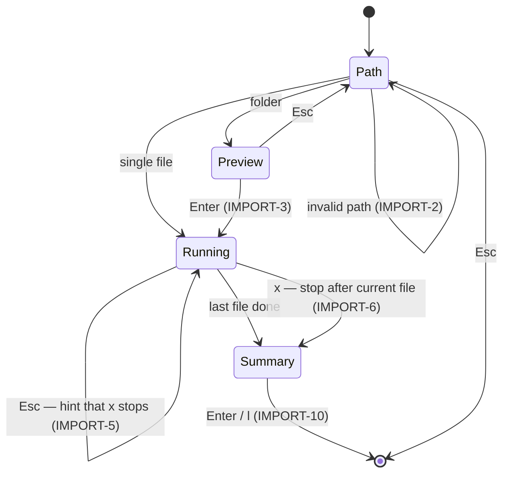

# Flows

The authoritative description of what a user does in bookman-tui and what the
app does in response. It serves three purposes:

- **Spec.** Behaviour not described here is not a feature. Changing a flow
  means editing this file first, then the code.
- **Tests.** Every rule has an ID (`IMPORT-6`). A test that checks a rule
  names it: `test_import_6_stop_keeps_finished_files`. A rule with no test is
  unverified.
- **User documentation.** Each flow opens with a short *In short* paragraph
  written for the user; the rules under it are for us.

**Simplicity check:** each flow has a key budget, the keystrokes the common
path should take. If an implementation needs more, simplify the flow before
accepting the extra keys.

Architecture context: `docs/ARCHITECTURE.md` (ADR numbers cited below).
Library behaviour quoted here belongs to bookman, which is authoritative for
it; this file only states what the user sees.

**bookman baseline:** 1.3.0 @ `1bdad64`. Claims about bookman's behaviour or
limits carry a `[bookman 1.3.0 @ 1bdad64]` tag; re-check them when the baseline moves
(see CLAUDE.md).

---

## Global rules

- **G-1** The interface never freezes. Anything that touches the network or
  imports files runs in the background, and the screen keeps responding (ADR-4).
- **G-2** Only one change to the library runs at a time. While one is running,
  every other action that would change the library is refused with a notice
  saying what's in progress. Browsing and searching stay available (ADR-4).
- **G-3** A book stays selected across any change to it, including a title
  edit that renames its folder (ADR-3). Exceptions: a removed book
  (REMOVE-3) and `v` working through the review queue (REVIEW-2).
- **G-4** When bookman refuses something it expected to (a `BookmanError`),
  show its message in plain words in the context where it happened: inline in
  a form, otherwise as a notification. Nothing is lost; the user can correct
  and retry. Any other error is a bug and is not dressed up.
- **G-5** `q` quits from the browser. `Esc` closes the current screen or
  dialog, or clears the search from the browser. Quitting is refused while an
  import is running (G-2); stop it first with `x` on the import screen
  (IMPORT-6).
- **G-6** `?` shows the keys available on the current screen.

---

## START — Launching

*In short:* run `bookman-tui`, optionally with `--library DIR`. It opens the
same library the `bookman` command uses. If none is set up yet, you're asked
where it should go.

- **START-1** The library is chosen in this order: `--library DIR`, then
  `$BOOKMAN_LIBRARY`, then the saved bookman config. This is bookman's own
  precedence; the TUI opens the library only through `configured_library`
  and adds nothing to it [bookman 1.3.0 @ 1bdad64].
- **START-2** If a library is found, the browser opens with every book loaded.
- **START-3** If no library is configured, the Setup flow runs instead.
- **START-4** If the saved config file exists but is invalid, show the error
  and the file's path, then offer Setup (which replaces the file) or quit.
  This applies even with `--library` or `$BOOKMAN_LIBRARY`: bookman reads the
  config for the metadata source whichever way the library was named
  [bookman 1.3.0 @ 1bdad64].
- **START-5** If the chosen library can't be opened, say why with the path
  and where it was named (SETTINGS-1), and offer retry (`r`), choose another
  folder (Setup, `s`), or quit (`q`). The reasons: the folder doesn't exist
  (e.g. a drive that isn't connected), the path is a file, or the folder
  holds other files and is not a library. A missing library is never
  silently recreated empty [bookman 1.3.0 @ 1bdad64].

## SETUP — Choosing a library (first run)

*In short:* type or tab-complete a folder. It's created if it doesn't exist,
and remembered for both `bookman-tui` and `bookman`.

Key budget: `Enter`, `Enter` to accept the suggested folder; otherwise edit
the name first.

- **SETUP-1** A path input with tab completion (same widget as IMPORT-1),
  pre-filled with a suggested folder inside the current one (home shown as
  `~`), cursor at the end. The suggestion is the first of `Books`, `Ebooks`,
  `Library`, `MyBooks` that `Enter` would accept (new, empty, or an existing
  library), else `Books`. `~` is expanded and a relative path is taken from
  the current folder. A line under the input says what `Enter` will do and
  names the full path (SETUP-2..5). `ctrl+q` quits.
- **SETUP-2** If the folder doesn't exist, say it will be created before
  continuing. One confirmation, no second dialog: the first `Enter` says
  "Press `Enter` again to create `<path>`", the second creates it, and
  editing the path cancels the confirmation.
- **SETUP-3** On confirm, the library is opened (created if needed), then
  its path is saved to bookman's config keeping the other saved settings
  (e.g. offline), and the browser opens on it (empty: BROWSE-6). If opening
  fails, nothing is saved (SETUP-4). The exception is a config file that
  can't be read (START-4): it is replaced first, since bookman reads it to
  open any library [bookman 1.3.0 @ 1bdad64].
- **SETUP-4** If the path names an existing file rather than a folder, or
  can't be created, the error shows inline and nothing is saved.
- **SETUP-5** An existing bookman library is recognised as the path is
  typed ("Existing library: `Enter` opens it") and opened without a
  confirmation. Any other folder that already has something in it (hidden
  files aside) is refused inline: "A library needs an empty folder: bookman
  fills it with its own copies of your books. Choose a new or empty folder,
  then import from this one." Nothing is saved. An empty folder is used as
  is [bookman 1.3.0 @ 1bdad64]. Pointing a library at an already organised
  collection is in *Not yet*.
- **SETUP-6** When Setup was reached because `--library` or
  `$BOOKMAN_LIBRARY` named a library that couldn't be opened (START-5), the
  chosen folder is saved and opened for this session, and a notification
  says the flag or variable still takes precedence at the next launch. The
  header shows the chosen folder as coming from `config`.
- **SETUP-7** `Esc` backs out one step at a time: it first cancels a pending
  create confirmation (SETUP-2). When Setup was opened from a start problem
  (START-4/5, `s`), it then returns to that screen. On first run there is
  nothing to return to, so the hint line says "Press `Esc` again to quit",
  and a second `Esc` quits. Editing the path or `Enter` cancels it. Nothing
  is saved either way.

## BROWSE — The library browser (home)

*In short:* a list of every book, with details of the selected one beside
it: cover, author, ISBN, formats, and how sure bookman is about the match.

- **BROWSE-1** The table shows title, author, formats (e.g. `EPUB PDF`), and a
  marker on books that need review. Ordered by title, ignoring a leading
  "The", "A" or "An" (*The Hobbit* sorts under H).
- **BROWSE-2** Up/down (and `j`/`k`) move the selection. The detail pane
  follows it.
- **BROWSE-3** The detail pane shows:
  - the cover, or a placeholder if there's none or it can't be drawn (ADR-5)
  - title, author, ISBN
  - the formats; a format bookman couldn't read shows its advice sentence
    (`ReadIssue.advice`)
  - one status line answering "can I trust these details?", first match wins:
    - `✓ Checked by you` (reviewed), with how bookman had matched it on a
      muted line under it: "matched online by ISBN", "matched online by
      title and author", "matched online by title only", "not found online"
      or "couldn't read inside the file"
    - `? Needs review` with every reason that applies, one per line, in this
      order: "couldn't read inside the file, so it wasn't looked up online"
      (every file unreadable), otherwise "not found online"; "matched online
      by title only"; "formats grouped by title only"
    - `✓ Matched online by ISBN` / `✓ Matched online by title and author`
  - when the source spelled the author differently: "Open Library lists the
    author as …" (`record_author`). Case, spacing and the punctuation between
    initials don't count as different ("J. R. R." and "J.R.R."), and a book
    whose author came from the record gets no note
- **BROWSE-4** A footer always shows the book count and the review queue
  size: `340 books · 12 need review`. With a search active it shows how
  many are listed: `12 of 340 books · 12 need review`.
- **BROWSE-5** `ctrl+r` reloads the library from disk, to pick up changes made
  by the `bookman` command or by hand. The selection is kept (G-3), or moves to
  the nearest book if the selected one is gone. When the reload finishes, a
  notification confirms it with the count and what changed: "Reloaded · 31
  books", or "Reloaded · 33 books (2 new, 1 gone)".
- **BROWSE-6** An empty library shows "No books yet — press `i` to import"
  instead of an empty table.
- **BROWSE-7** The detail pane sits right of the table at a fixed width
  (about 40 columns); the table takes the rest, and the title column gets the
  spare room. On a terminal too narrow for both (under about 100 columns) the
  pane is hidden and `Enter` opens the selected book's details as their own
  screen; `Esc` returns to the list. Widening the terminal while it's open
  doesn't close it, so no screen changes under the user; `Esc` returns to
  the list, which then shows the pane.
- **BROWSE-8** `o` cycles the sort: Title → Author → Recently added. The
  status line names the sort and grouping in use: `340 books · 12 need
  review · by author · grouped by status` (the grouping part only when
  grouped). Author sorts by the author as stored (first name first) until
  bookman offers a surname sort key, books with no author last, ties in
  title order. Recently added is newest first by import date
  (`Book.added`); books imported before bookman recorded it have none and
  come last, in title order [bookman 1.3.0 @ 1bdad64]. Not built yet: `o` toggles Title and
  Author until it is.
- **BROWSE-9** `g` cycles the grouping: none → Author → Status (needs review,
  matched online, checked by you) → Format. Each group has a header row with
  its size (`── Frank Herbert (3) ──`); the selection skips header rows.
  Groups come in a fixed order: authors A–Z as stored, with "Unknown
  author" last; the three statuses in the order above, a book going where
  its BROWSE-3 status line puts it; formats in bookman's order (EPUB, PDF,
  MOBI). Books follow the sort within each group. Books with several
  formats appear under each of their formats. Search applies within groups:
  a header counts the matching books, and a group with none is left out.
- **BROWSE-10** The sort and grouping last used are remembered for the next
  session.
- **BROWSE-11** `F` (shift+f) opens the selected book's folder in the
  system file manager (Finder on macOS), which shows all its formats; open
  one from there. A capital so that pressing `g` repeatedly can't hit it by
  accident. Also on the narrow-terminal details screen (BROWSE-7). If the
  folder is gone (moved or deleted by hand since the last load), a
  notification says so and suggests `ctrl+r`. Key budget: `F`.
- **BROWSE-13** BROWSE-11 only reads the library, so it stays available
  while a change to it runs, such as a lookup (G-2).

## FIND — Search

*In short:* press `/` and type to narrow the list by title, author or ISBN.
`Enter` takes you back to the list of matches; `Esc` clears the search.

Key budget: `/`, type, `Enter` (focus goes back to the list).

- **FIND-1** Search is a case-insensitive substring match on title, author
  or ISBN. It updates on every keystroke (ADR-3). An ISBN matches with or
  without hyphens and spaces. The search box sits at the top of the Library
  panel: `/` shows and focuses it, and it stays visible while a search is
  active, so the list always shows what narrowed it. `/` again edits it.
- **FIND-2** `Esc` clears the search and shows all books again, from the
  search box or from the list (G-5). Focus goes to the list and the box hides.
- **FIND-3** *Withdrawn: the review filter moved out of search, then was
  dropped; the review queue is the Needs review group (BROWSE-9). Filters
  are in Not yet.*
- **FIND-4** *Withdrawn with FIND-3.*
- **FIND-5** If nothing matches, the table says so and names the search:
  `No books match "dune"`.
- **FIND-6** While typing, the selected book stays selected if it still
  matches; otherwise the first match is selected. When a book stops
  matching because of an action (e.g. a title edit), it leaves the list and
  the selection moves to the next book.
- **FIND-7** Beside the search box, a count says how many books match and
  on which fields: `3 books · 3 title · 0 author · 0 ISBN`. Each field
  counts every book that matched on it, so a book matching on title and
  author counts in both, but once in the book total. Hidden while the search
  is blank.

## IMPORT — Adding books

*In short:* press `i` and give a file or folder (with tab completion). For a
folder you first see what's in it and what's new, and can pick just the books
you want. Then bookman looks each one up online and files it while a progress
bar shows how long is left. The import holds the screen until it ends or
you stop it with `x`. Your original files are copied, never moved or
changed, and importing the same folder again only brings in what's missing.

Key budget: `i`, type or tab-complete the path, `Enter`, `Enter` to import
everything new; `Enter` on the summary. One book from a folder of many: add
`a`, `/` + name, `Space`.

- **IMPORT-1** Path input with tab completion: `Tab` completes the longest
  unambiguous part, and a second `Tab` lists the choices. It's pre-filled
  with the current folder and a trailing `/` (home shown as `~`), so a typed
  name visibly lands inside it; the hint line names the full path. `~` is
  expanded and a relative path is taken from the current folder.
  An "include subfolders" toggle (off by default, as in bookman) applies to
  folders.
- **IMPORT-2** A path that doesn't exist, or an unsupported single file, is an
  inline error. Nothing starts. A single supported file skips the preview
  (IMPORT-3) and starts at once, unless the library already holds it: then
  the error line names the book that has it, and nothing starts.
- **IMPORT-3** A folder opens a preview before anything is imported:
  - a header with the counts: files found, new, already in the library,
    unsupported
  - a line saying each new book is looked up online, so a large folder can
    take minutes
  - every file, marked *new*, *already in library* or *unsupported*
  - new files start ticked; files already in the library and unsupported
    ones can't be ticked
  - `Space` toggles the selected file, `a` ticks or unticks all new files,
    `/` filters the list by file name. The filter only changes what's
    shown: ticks on hidden files stay, `Enter` still imports every ticked
    file, and while ticked files are hidden the hint says how many ("Enter
    imports 34 files, 33 hidden by the filter")
  - `Enter` imports the ticked files ("Enter import 180"); nothing ticked,
    nothing starts. `Esc` goes back to the path.

  *Already in library* comes from bookman's content check
  (`Library.find_files`: offline, each file read once to hash it). A file
  bookman placed before it recorded hashes isn't recognised until it's
  imported again [bookman 1.3.0 @ 1bdad64].
- **IMPORT-4** While running, the import screen shows:
  - a progress bar with files done out of total and the time left,
    estimated from the pace so far
  - the file currently being looked up (bookman reports it before the network
    lookup)
  - running counts: imported, already in library, skipped, failed,
    conflicts
  - a scrolling log of each file's result
- **IMPORT-5** The import runs in the foreground: while it runs, `Esc` stays
  on the import screen and the hint says `x` stops it (IMPORT-6). Going back
  to browsing during an import is in *Not yet* (ADR-10).
- **IMPORT-6** `x` on the import screen stops the import after the current
  file finishes. Files already imported stay imported.
- **IMPORT-7** One bad file never stops the batch; it's counted and listed.
- **IMPORT-8** If Open Library can't be reached, a notification says books
  are being added from their files only, and the import carries on. Those
  books are remembered for this session (IMPORT-10). bookman records the
  failure on the book (`Book.lookup` is `FAILED`) [bookman 1.3.0 @ 1bdad64].
- **IMPORT-9** A conflict means the book already has a *different* file of the
  same kind. Nothing was changed [bookman 1.3.0 @ 1bdad64]. Each conflict
  shows the refused file, the book it matched and that book's existing file,
  and how they were matched, with what to do:
  - "same ISBN": likely the same book in a different copy. "To use the new
    file instead, copy it over `<existing file>` by hand, keeping that
    file name, then `ctrl+r`."
  - "same title only": maybe not the same book. The same advice if it is;
    if it's a different book, bookman can't keep them apart yet (see
    *Not yet*).
- **IMPORT-10** The summary opens when the import ends or is stopped:
  - counts first; if stopped, "Stopped at 40 of 212. Import the same folder
    again to continue."
  - then, in this order, **Conflicts** (IMPORT-9), **Failed** (file and
    reason), **Imported** (resulting book, marked when it needs review),
    **Already in library** (file and the book that has it; nothing changed),
    **Skipped** (unsupported files, e.g. `.mobi`). Empty sections are
    omitted.
  - `l` looks up again the books imported without Open Library
    (IMPORT-8), in the background like LOOKUP-1, and returns to the
    browser; one notification then says how many were updated ("Looked up
    3 books · 2 updated"), or that Open Library still can't be reached.
    `l` is offered only when there are such books. `Enter`, or the
    `Back to library ⏎` button that stays visible under the summary,
    returns to the browser with the first imported book selected. The
    library is reloaded either way.

## EDIT — Correcting a book

*In short:* press `e` on a book to fix its title, author or ISBN. Saving
marks the book as reviewed, so later imports won't overwrite your
correction, and then looks it up online with what you typed, unless you
untick "Look up after saving".

Key budget: `e`, edit the field, `Enter`.

Designed in M10 (2026-10-12) against the hardest case: a book whose file gave
little or nothing and that wasn't found online. A dialog was chosen over
editing in the detail pane (the pane is hidden on narrow terminals,
BROWSE-7, and a dialog makes the editing state plain) and over a book screen
(too much for three fields; the place for richer editing later, see
*Not yet*).

- **EDIT-1** `e` opens a dialog over the browser, which is dimmed behind it.
  It shows first what helps work out what the book is: its file names,
  bookman's advice for a file it couldn't read (`ReadIssue.advice`), and
  why it needs review (BROWSE-3's reasons). Then title, author and ISBN,
  filled with the current values, and a "Look up after saving" checkbox
  (EDIT-7). Focus starts on title; `Tab` and `shift+tab` move between them.
- **EDIT-2** When the source spelled the author differently
  (`record_author`), a button offers it: "Use Open Library's spelling: …".
- **EDIT-3** `Enter` in any field saves, and `Esc` cancels. If nothing
  changed, saving just closes: the book is **not** marked reviewed as a
  side effect, and nothing is looked up.
- **EDIT-4** Only changed fields are sent. An emptied author or ISBN field
  clears that field. An empty title is refused inline.
- **EDIT-5** An invalid ISBN is refused inline. The dialog stays open with
  everything typed kept (G-4).
- **EDIT-6** After saving, the book shows as reviewed. A title change
  renames its folder and files; the book stays selected (G-3). One
  notification reports the save and, when one ran, the lookup (LOOKUP-2):
  "Saved", "Saved · Found a cover", "Saved · Open Library can't be
  reached".
- **EDIT-7** With "Look up after saving" ticked, saving goes on to look the
  book up with the corrected fields (LOOKUP-1), as part of the same change
  to the library (G-2). `Space` toggles it. It's ticked at first, and the
  last choice is remembered for the next edit and the next session
  (ADR-9), so a run of quick fixes can go without lookups.
- **EDIT-8** The lookup only runs when it could help: the book wasn't
  matched online, or it has no cover, author or ISBN. Otherwise a reviewed
  book has nothing to gain (LOOKUP-3).

## REVIEW — Marking books reviewed

*In short:* press `v` to mark the selected book as checked, so it leaves the
review queue and keeps its details on later imports. Press `v` again to put
it back in the queue.

Key budget: `v`.

- **REVIEW-1** `v` toggles reviewed on the selected book (`mark_reviewed`).
  Nothing else about the book changes.
- **REVIEW-2** When grouped by Status (BROWSE-9) and `v` moves a book out of
  Needs review, the selection moves to the next book in Needs review (the
  previous one if it was the last), so the queue can be worked through one
  key at a time. It stays on the moved book when Needs review is now empty.
  This is the one exception to G-3; in every other case the selection
  follows the book.

## LOOKUP — Re-identifying a book

*In short:* press `l` to look the selected book up online again, e.g. after
fixing its title, or to get a missing cover. Details you corrected by hand are
never overwritten.

Key budget: `l`.

- **LOOKUP-1** `l` runs `reidentify` on the selected book in the background.
  The book shows as "looking up…" meanwhile. It counts as a change to the
  library (G-2). Saving an edit runs the same lookup (EDIT-7).
- **LOOKUP-2** When it finishes, a notification says what changed (e.g.
  "Found a cover", "Identified by ISBN", "Author filled in"), judged by
  comparing the book before and after. If nothing changed: "No better match
  found". If Open Library can't be reached: "Open Library can't be
  reached", and nothing changes. With lookups turned off in bookman's
  settings (`Config.offline`): "Lookups are off" [bookman 1.3.0 @ 1bdad64].
- **LOOKUP-3** A reviewed book keeps its title, author and ISBN; only a
  missing cover or empty fields can be filled in (bookman's rule, stated so
  the user expects it). A reviewed book that the lookup matched still isn't
  recorded as matched online, so its status line keeps saying how it was
  matched before [bookman 1.3.0 @ 1bdad64] (inbox 2026-10-06).

## REMOVE — Removing a book

*In short:* press `D` to remove the selected book from the library. You're
asked first. Your original files, wherever you imported them from, are never
touched.

Key budget: `D`, then confirm.

*Not built: waits for bookman to offer removing a book (inbox 2026-10-06;
none in [bookman 1.3.0 @ 1bdad64]). Until then, delete the book's folder by
hand and press `ctrl+r`.*

- **REMOVE-1** `D` opens a confirmation naming the book, its folder and its
  formats. Cancel has focus, so `Enter` alone removes nothing; `Esc`
  cancels.
- **REMOVE-2** Removing takes the whole book: its folder, every format and
  its cover. Removing one format of a book waits for bookman (FEATURES K8).
- **REMOVE-3** It counts as a change to the library (G-2). Afterwards the
  selection moves to the nearest book (as BROWSE-5 does for a book that's
  gone) and a notification names the book removed.
- **REMOVE-4** For a book bookman couldn't read, whose advice is to delete it
  and import it again (EDIT-1), `D` is that delete.

## SETTINGS — Configuration

*In short:* there's no settings screen yet. The header always shows which
library is open.

- **SETTINGS-1** The header shows the open library's path on every screen
  (`~` for the home folder), and where that choice came from: `--library`,
  `$BOOKMAN_LIBRARY`, or `config` (`locate_library`) [bookman 1.3.0 @ 1bdad64].
  Nothing in the TUI switches or changes the library.
- **SETTINGS-2** A settings screen (`s`) arrives with metadata sources, once
  bookman supports configuring them (ADR-6).

---

## Not yet

Deliberately out of scope until bookman offers an API for it, or we decide
otherwise. Each needs a flow here before it's built.

- Resolving a format conflict in the TUI (keep or replace a file, or split a
  wrongly grouped book). bookman has no API for either; merge and split are
  planned there [bookman 1.3.0 @ 1bdad64].
- Choosing and configuring metadata sources: bookman deferred a source
  registry until it has a second source; today the one choice is online or
  offline (`Config.offline`) [bookman 1.3.0 @ 1bdad64] (ADR-6). Whether and
  where the TUI exposes the offline switch is undecided (*Open questions*).
- Opening the book in the system's default reader (`Enter`, with a format
  choice when there are several). Chosen against for now in favour of
  BROWSE-11: a reader is an outside app we can't watch (it may be slow to
  start, steal focus or ask which app to use), and Apple Books, the macOS
  default for EPUB, imports a copy into its own library. If added, `Enter` moves from narrow-terminal details
  (BROWSE-7) to opening, and details move to `d`.
- Switching libraries from inside the TUI, as a first-class feature of its
  own rather than a setting (open another library for a look vs. change the
  default; whether to keep a list of recent libraries). Until then, use
  `--library DIR` or `$BOOKMAN_LIBRARY`. A library can be moved freely (see
  above), so no flow is needed for that.
- Richer editing on a book screen of its own (the M10 alternative to the
  EDIT dialog): choosing among lookup results when the match is wrong
  (needs bookman, inbox 2026-10-06; FEATURES K5), more sources than Open
  Library, and setting a cover by hand. A cover by hand is more likely a
  link (a bookshop page) than an image file on disk, so it waits for more
  sources; bookman's `set_cover` takes a local image
  [bookman 1.3.0 @ 1bdad64]. Until then, a cover comes from Open Library
  only (`l`).
- Queuing changes instead of refusing them (G-2): an edit saved while a
  lookup runs is refused until it finishes. Queuing would let a run of
  edits go on while lookups catch up. Revisit if refusals get in the way;
  "Look up after saving" (EDIT-7) is the answer for now.
- Telling the user about books bookman can't read: `scan` skips a broken
  metadata.json without saying so [bookman 1.3.0 @ 1bdad64] (inbox
  2026-10-06).
- A cover grid view: a toggle that swaps the table for covers with titles
  underneath, same search, sort and grouping, for browsing by what a book looks
  like. Until then, flipping through with `j`/`k` shows each cover in the
  detail pane. Deferred for speed: many images at once may be slow, and
  half-block covers are hard to recognise at thumbnail size (ADR-5); measure
  with the single detail-pane cover first.
- Field prefixes in search (`author:le guin`, `isbn:978…`) to narrow to one
  field. Plain search (FIND-1) already covers title, author and ISBN;
  prefixes pay off once bookman exposes more fields (publisher, year).
- Starting from books you already have (SETUP-5 only refuses). Two
  audiences to design for: loose files (e.g. a Downloads folder), where
  "new library + import from here" fits; and an organised collection (a
  hand-sorted folder, a Calibre library), where the user wants that folder
  to become the library rather than be copied into a subfolder of it. A
  library can be moved freely: book files are found relative to their folder
  and the index stores folder names only [bookman 1.3.0 @ 1bdad64].
- Filters (was FIND-3/4, then M8): a toggle showing only some books, e.g.
  those that need review or this import's books (which IMPORT-10's `r`
  needed). Dropped on 2026-10-03: grouping by Status (BROWSE-9) already
  gathers the review queue with its count, and users know their own
  library well enough to find the rest by search or grouping. Revisit if
  more criteria come up (no cover, no ISBN) or the review queue gets large.
- Importing in the background (was IMPORT-5, M9): `Esc` back to the
  browser while the import carries on, its progress in the browser footer,
  `i` reopening it and the summary opening on its own. Deferred on
  2026-10-05: with every write refused during an import (G-2), it buys only
  browsing, and it makes every later write path (edit, lookup, mark
  reviewed, reload) depend on the guard. The app-owned job (ADR-10) lets it
  be added later without rework.

- Copying a book's file path (was BROWSE-12, M11): `c`, with a format
  choice when there are several. Dropped on 2026-10-13: BROWSE-11 opens the
  folder, and a path mostly helps shell or SSH use, which is not the
  priority (the app is local-first). If added, copy the folder path: one
  key, no format choice. A natural home is the toolbar below.
- A small toolbar in the details pane for rare actions: open folder
  (BROWSE-11), copy path, remove (REMOVE). It would make these easy to find
  without spending keys. To settle in a design pass with mockups: icons
  render at different widths across terminals and fonts (plain symbols or
  short labels may be safer), with `tooltip` text on hover; buttons need
  `Tab` presses, so frequent actions keep a key; the pane is hidden on
  narrow terminals (BROWSE-7), so it would sit on the details screen there;
  remove needs its REMOVE confirmation and distance from the harmless
  buttons.
- A richer details screen of its own, beside the pane used for browsing: a
  summary of the book from online sources and fields of the user's own,
  such as notes. bookman's `Book` has neither a description nor a notes
  field [bookman 1.3.0 @ 1bdad64], so both need bookman first. Notes
  overlap with EDIT, which a design pass would settle.

## Open questions

- **BROWSE-8** Surname order needs an author sort key (in bookman's
  backlog) [bookman 1.3.0 @ 1bdad64].
- **Offline switch** bookman 1.3.0 can save an offline setting, which the
  `bookman` command doesn't switch either. Does the TUI get a toggle (a
  settings screen, which ADR-8 holds back), and should the header say when
  lookups are off?
